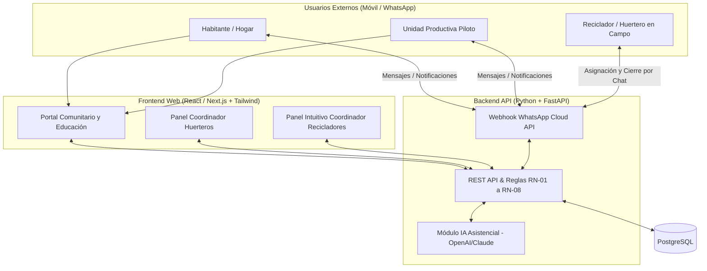

# EcoConecta — Villas de San Pablo

Plataforma digital accesible para conectar a la comunidad, unidades productivas, huerteros y recicladores de oficio en la gestión comunitaria de residuos y la economía circular del megabarrio **Villas de San Pablo (Barranquilla)**.

Proyecto desarrollado en el marco de la **Hackathon Universidad Libre × Fundación Santo Domingo**.

---

## 1. Propósito y Alcance del MVP

EcoConecta centraliza la educación ambiental, el registro de solicitudes de recolección y la coordinación operativa entre dos colectivos comunitarios:
1. **Flujo Orgánico (Colectivo de Huerteros):** Gestión de residuos orgánicos domiciliarios (día de por medio) y de unidades productivas (diario) para compostaje en la huerta comunitaria.
2. **Flujo Reciclable (Colectivo de Recicladores):** Gestión de materiales aprovechables mediante rutas comunitarias organizadas.

### Decisiones Clave de Diseño Operativo
* **Paneles exclusivos para Coordinadores:** Los recolectores en campo no requieren aprender interfaces web complejas; reciben sus asignaciones y reportan cierres directamente desde **WhatsApp**.
* **Interfaces diferenciadas por perfil tecnológico:**
  * **Panel Coordinador de Recicladores:** Diseño ultra-intuitivo de 2 toques (asignar reciclador + disparar mensaje automático a WhatsApp).
  * **Panel Coordinador de Huerteros:** Tablero operativo completo con filtros, gestión de rutas y control de compostaje.
  * **Portal Comunitario (Habitantes y Unidades Productivas):** Vista móvil ligera para consulta educativa, solicitud de recolección, seguimiento en tiempo real y consulta de **puntos adaptables**.
* **Comunicación Bidireccional (WhatsApp Cloud API + IA):** Integración con **WhatsApp Business Cloud API** para notificaciones automáticas y atención asistida por IA entrenada en las reglas de separación de Villas de San Pablo (manteniendo siempre la decisión operativa bajo control humano).

---

## 2. Stack Tecnológico (100% Autorizado)

* **Frontend:** React / Next.js + Tailwind CSS (Diseño *mobile-first* y responsivo para tablet).
* **Backend:** Python + FastAPI + SQLAlchemy + Pydantic.
* **Base de Datos:** PostgreSQL.
* **Mensajería:** WhatsApp Business Cloud API (Graph API).
* **Inteligencia Artificial:** OpenAI API / Claude API (asistente educativo y clasificación orientativa).
* **Infraestructura:** Docker & Docker Compose.

---

## 3. Arquitectura del Sistema



---

## 4. Reglas de Negocio Implementadas

* **RN-01 (Separación de flujos):** Enrutamiento automático de solicitudes orgánicas a Huerteros y reciclables a Recicladores.
* **RN-02 (Programación):** Una solicitud solo pasa a estado `PROGRAMADA` al registrar **día, hora y persona encargada**.
* **RN-03 (Asignación):** Toda atención queda vinculada a un coordinador y a un recolector responsable.
* **RN-04 (Trazabilidad):** Identificador único, historial auditable de estados y marcas de tiempo por cada solicitud.
* **RN-05 (Cierre):** Los puntos se acreditan únicamente después de confirmar la recolección.
* **RN-06 (Puntos adaptables):** Cálculo parametrizable por el Administrador (valores sujetos a validación oficial de la Fundación Santo Domingo).
* **RN-07 (Privacidad):** Datos de contacto y dirección visibles únicamente para los perfiles autorizados que atienden la solicitud.
* **RN-08 (Piloto):** Soporte para habilitar cuentas piloto (hogares y unidades productivas preseleccionadas por FSD).

---

## 5. Ejecución Local con Docker

### Prerrequisitos
* Docker y Docker Compose instalados.
* Archivo `.env` configurado a partir de `.env.example`.

### Pasos de arranque
```bash
# 1. Clonar el repositorio
git clone https://github.com/<usuario-equipo>/ecoconecta-villas-san-pablo.git
cd ecoconecta-villas-san-pablo

# 2. Copiar plantilla de variables de entorno
cp .env.example .env

# 3. Levantar servicios (PostgreSQL, Backend FastAPI y Frontend)
docker-compose up --build -d

# 4. Cargar datos semilla (Usuarios piloto, coordinadores y reglas de puntos)
docker-compose exec backend python app/seed.py
```

* **Frontend:** `http://localhost:3000`
* **Documentación API (Swagger):** `http://localhost:8000/docs`

---

## 6. Variables de Entorno Requeridas (Sin Valores)

Crear un archivo `.env` en la raíz con las siguientes claves:

```env
# Base de datos PostgreSQL
POSTGRES_USER=
POSTGRES_PASSWORD=
POSTGRES_DB=
DATABASE_URL=

# Seguridad Backend
SECRET_KEY=
ALGORITHM=HS256

# WhatsApp Business Cloud API
WHATSAPP_API_TOKEN=
WHATSAPP_PHONE_NUMBER_ID=
WHATSAPP_VERIFY_TOKEN=
WHATSAPP_API_VERSION=v21.0

# Proveedor de IA Autorizado (OpenAI o Anthropic)
AI_PROVIDER=openai
OPENAI_API_KEY=
ANTHROPIC_API_KEY=

# Frontend
NEXT_PUBLIC_API_URL=
```

---

## 7. Despliegue en Nube

* **URL Pública de la Aplicación:** `[Pendiente: insertar URL desplegada antes del cierre]`
* **Infraestructura:** Contenedores Docker desplegados en `[Proveedor Cloud: Render / Railway / Azure]`, base de datos gestionada en PostgreSQL.

---

## 8. Escenario Oficial de Demostración (5 Pasos)

1. **Unidad Productiva Piloto** registra solicitud de **residuos orgánicos**.
2. El sistema enruta al **Coordinador de Huerteros**, quien revisa y asigna un **Huertero**.
3. Se registra y notifica al usuario **día, hora y persona encargada** (en plataforma y vía WhatsApp).
4. El **Huertero** confirma la recolección; el sistema actualiza el estado a `RECOLECTADA` y asigna **puntos adaptables**.
5. Un **Hogar** registra solicitud de **residuos reciclables** y el sistema la dirige al **Coordinador de Recicladores**, quien asigna y envía la orden por WhatsApp en un toque.